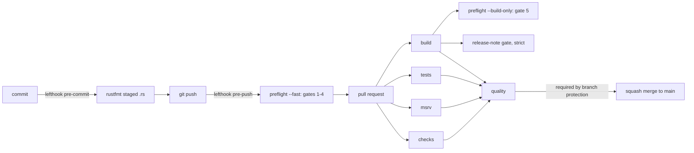

# ADR: AI governance, preflight gates and CI quality check

- **Status:** Accepted 2026-10-29
- **Date:** 2026-10-29
- **Scope:** repository process, `scripts/`, `.github/`, `lefthook.yml`, `rust-toolchain.toml`, `bindings/evergreen-js` packaging, `rust-version` in the root `Cargo.toml`. No Rust source changes.

## Context

Evergreen is public and about to take outside contributions through Drips Wave, and
some of the work will be done by AI coding agents. Today:

- CI runs one job on unpinned `stable`: fmt, clippy, test and the wasm build of the
  three examples. It does not build docs, does not touch the TypeScript binding,
  does not check the declared minimum Rust version, and has no single check that
  branch protection could require.
- `rust-version = "1.81"` in `Cargo.toml` is wrong. `soroban-sdk 26.1.0` declares
  `rust-version = "1.91.0"` (its `Cargo.toml` in the local registry). Checked
  locally: `cargo +1.91.0 check --workspace --all-targets --locked` passes,
  `cargo +1.90.0 check -p evergreen-core --locked` fails dependency resolution.
- There is no `rust-toolchain.toml`, no git hooks, no release notes, no ADRs.
- `bindings/evergreen-js` has no lockfile and is named `@evergreen/js`, a scope the
  project does not own, and is not marked private.
- Mainnet `contract_max_size_bytes` is 131,072 (read with
  `stellar network settings --network mainnet` on 2026-10-29). The examples build
  to 3 to 7 KB today, so nothing guards the limit yet.

## Decision

1. `AGENTS.md` is the rulebook for every agent; `CLAUDE.md` is `@AGENTS.md`.
   Craft rules, including the layer diagram, live in
   `.claude/skills/evergreen-engineering-standards/SKILL.md`.
2. Non-trivial work needs two ADRs under `docs/adr/` and explicit maintainer
   approval before code. Bugs are fixed red-green. Error masking is forbidden
   (no `unwrap` on external data, no unexplained `#[allow]`, no `unsafe`).
3. `scripts/preflight.sh` is the single entry point with five gates:
   1. `cargo fmt --all -- --check`
   2. `cargo clippy --workspace --all-targets --locked -- -D warnings`
   3. `cargo check --workspace --all-targets --locked`,
      `RUSTDOCFLAGS="-D warnings" cargo doc --workspace --no-deps --locked`,
      `npm --prefix bindings/evergreen-js run typecheck`
   4. `cargo test --workspace --locked`
   5. wasm32v1-none release build of every example, a size check against
      131,072 bytes, and the binding's `tsc` build.

   `--fast` skips gate 5. `--build-only` runs gate 5 alone for CI. The script
   fails before any gate if `cargo`, `rustup`, `npm`, the `wasm32v1-none` target or
   the binding's `node_modules` is missing.
4. `rust-toolchain.toml` pins `1.91.1` with `rustfmt`, `clippy` and
   `wasm32v1-none`. `rust-version` becomes `1.91`.
5. `lefthook.yml`: pre-commit runs rustfmt on staged `.rs` files and re-stages
   them; pre-push runs `./scripts/preflight.sh --fast`. Hooks are optional.
   `min_version: 2.0.4` because `glob_matcher` is rejected by 2.0.3 and older,
   and 2.0.0 was observed to skip the rustfmt job silently instead of failing.
6. CI has five jobs: `checks` (fmt, clippy, check, rustdoc, tsc), `msrv`
   (`cargo +1.91.0 check`), `tests`, `build` (preflight gate 5 and the strict
   release-note gate), and `quality`, which fails unless every other job
   succeeded. Branch protection requires `quality` only. Actions are pinned to
   commit SHAs and the workflow token is `contents: read`.
7. Any change under `crates/`, `bindings/`, `examples/` or to the root
   `Cargo.toml` needs a release note in `docs/release-notes/`
   (`scripts/check_release_notes.sh`, strict in CI).
8. The binding is renamed `@vegaforge/evergreen-js`, marked `"private": true`,
   gets a `repository` field, `.nvmrc` (24) and a committed `package-lock.json`.

## Diagram



## Consequences

- Every PR pays about four parallel CI jobs. The wasm builds are small; the
  slowest job is the cached clippy and doc pass.
- Contributors need Node and `npm ci --prefix bindings/evergreen-js` to run the
  preflight, even for Rust-only changes. The trade is one script that checks
  everything CI checks.
- A toolchain bump is now a deliberate PR that edits `rust-toolchain.toml` and
  `RUST_TOOLCHAIN` in `ci.yml` together.
- `RUSTFLAGS=-D warnings` stays in CI (it was there before) but is not set by the
  preflight, so local builds keep their cache. Clippy with `-D warnings` over all
  targets catches the same warnings for the host target.
- The 131,072-byte limit is a constant in the preflight with its date and source.
  If the network raises it, the constant is updated in its own PR.
- The maintainer still has to apply branch protection by hand (see Verification).

## Alternatives considered

- **Husky and lint-staged**, as in the blueprint: needs a root `package.json` in a
  Rust workspace. lefthook is a single binary and reads one YAML file.
- **`dtolnay/rust-toolchain@stable` without a toolchain file**: builds drift as
  stable moves; a new clippy lint can break `main` with no code change.
- **Per-version action branches (`dtolnay/rust-toolchain@1.91.1`) pinned by
  SHA**: the action's docs say those branches are regenerated and old commits may
  be garbage collected, so the SHA is pinned on `master` with a `toolchain` input.
- **No MSRV job**: the 1.81 mistake shows the declared value drifts unless
  something builds on it.

## Verification

- `./scripts/preflight.sh`, `./scripts/preflight.sh --fast` and
  `bash scripts/check_release_notes.sh` pass in the worktree.
- `npx --yes lefthook@2.2.2 run pre-commit` and `run pre-push` pass.
- On the PR, CI shows `checks`, `msrv`, `tests`, `build` and `quality`, all green.
- After merge, the maintainer protects `main`:

  ```bash
  gh api -X PUT repos/vegaforge/evergreen/branches/main/protection \
    -f required_status_checks[strict]=true \
    -f required_status_checks[contexts][]=quality \
    -F enforce_admins=true \
    -F required_pull_request_reviews=null \
    -F restrictions=null \
    -F allow_force_pushes=false \
    -F allow_deletions=false
  ```

  and sets the repository to squash merge only with head branches deleted on merge.
