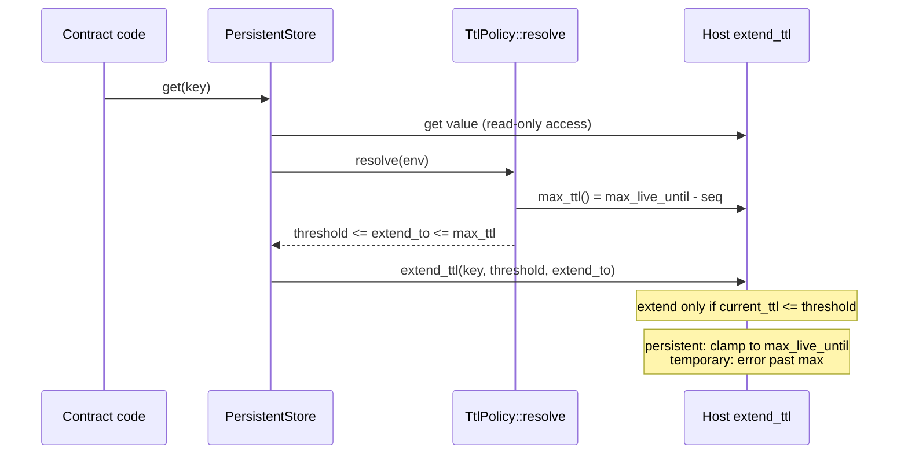

# ADR: Correct the TTL facts and lock the inclusive threshold

- **Status:** Accepted 2026-10-29
- **Date:** 2026-10-29
- **Scope:** `evergreen-core` rustdoc and tests, `crates/evergreen-core/README.md`,
  the root `README.md`, `docs/src/state-archival.md`,
  `docs/src/getting-started.md`, and the policy comments in
  `examples/token-with-policy` and `examples/rarely-written-state`. No change to
  any function body, public signature, or storage layout. Issue #18.

## Context

The docs describe TTL extension in four ways that do not match the host. Every
fact below was read from source in the local cargo registry
(`soroban-env-host 26.1.3`, `soroban-sdk 26.1.0`, the versions in `Cargo.lock`) or
from the live network with `stellar network settings` (stellar-cli 27.1.0) on
2026-10-29.

### 1. The threshold is inclusive

`soroban-env-host-26.1.3/src/storage.rs`, `Storage::extend_ttl` (line 532):

```rust
if ttl_ext_info.current_ttl <= threshold {
    self.apply_ttl_extension(host, key, ttl_ext_info, new_live_until)?;
}
```

`current_ttl` is `old_live_until - ledger_seq` (line 491). The SDK's test helper
`testutils::storage::Persistent::get_ttl` computes the same value
(`soroban-sdk-26.1.0/src/storage.rs`, line 717). So an entry whose remaining TTL
equals the threshold is extended. `policy.rs`, `lib.rs`, the core README, the root
README and `state-archival.md` all say "below". No test covers the equality case.

### 2. Persistent and instance extensions are clamped, not trapped

Same function, line 566:

```rust
// Clamp persistent entries to max network TTL (temporary entries
// wouldn't get here).
new_live_until = new_live_until.min(ttl_ext_info.max_live_until);
```

`prepare_extend_ttl` (lines 477 to 490) returns an `InvalidAction` error only for
temporary entries whose `extend_to` exceeds the network maximum. The contract
instance and contract code are persistent-durability entries
(`ledger_info.rs`, `get_key_durability`), so they are clamped too. The host also
errors when `threshold > extend_to` (line 542).

`TtlPolicy::resolve` says "Extending past it traps". That is wrong for both tiers
Evergreen supports today. The clamp in `resolve` is still worth keeping: it keeps
the threshold at or below the target (which avoids the `threshold > extend_to`
host error), and a future `TemporaryStore` (#7) needs it to avoid the temporary
error.

### 3. `max_ttl()` is one less than the network's `max_entry_ttl`

`ledger_info.rs` line 29: `max_live_until = sequence_number + (max_entry_ttl - 1)`.
`Storage::max_ttl()` in the SDK returns `max_live_until_ledger - sequence`
(`storage.rs` line 153). On mainnet that is `3_110_400 - 1 = 3_110_399` ledgers.
Docs that quote a maximum should say "read `env.storage().max_ttl()`" rather than
a number.

### 4. The network numbers in the docs are out of date

`state-archival.md` says the maximum is "around 535,679 ledgers, or about 30 days".
The root README says "A single CLI extension tops out near 30 days". Live values on
2026-10-29:

| Setting | Mainnet | Testnet | SDK test default (`testutils.rs` 285 to 287) |
|---|---|---|---|
| `max_entry_ttl` | 3,110,400 (about 180 days) | 3,110,400 | 6,312,000 |
| `min_persistent_ttl` | 2,073,600 (about 120 days) | 120,960 (about 7 days) | 4,096 |
| `min_temporary_ttl` | 17,280 (about 1 day) | 720 | 16 |

Day figures assume five-second ledgers.

Consequence for the examples: their policy is `TtlPolicy::new(17_280, 518_400)`,
"about 1 day threshold, about 30 days target". On mainnet a new persistent entry
already starts with 2,073,600 ledgers, so the first writes do not raise its TTL.
The policy only acts once the entry has decayed to 17,280 ledgers or fewer, and
then tops it up to 518,400. That is still a sensible target: each extension buys
30 days of rent rather than 180, so a busy entry pays a small amount often instead
of a large amount once, and an entry that stops being used is not prepaid for
half a year. The comments should say this rather than imply the target is the
entry's lifetime.

### 5. The footprint claim is probably wrong, and needs a network check

`PersistentStore::get` says "The extension makes a read part of the read-write
footprint." In the host, `extend_ttl` reaches the entry through
`prepare_extend_ttl`, then `get_with_live_until_ledger`, then `try_get_full`,
which calls `prepare_read_only_access` (`storage.rs` line 260) and enforces
`AccessType::ReadOnly`. Nothing on that path asks for read-write access. This
matches how `ExtendFootprintTTLOp` works on read-only footprint entries.

What the host source cannot show is what `simulateTransaction` puts in the
footprint and how rent is charged for a TTL change on a read-only entry. Issue #18
asks for a recorded testnet simulation before the sentence is reworded, so the
decision below makes that a gate.

## Decision

1. Write the boundary tests first (see Verification) and confirm they fail against
   a deliberately off-by-one `resolve`, then pass against the current code. The
   current code is correct; the tests lock the behaviour so a later change cannot
   silently skip extension at equality.
2. Replace "below" with "at or below" everywhere the threshold is described:
   `policy.rs` (struct docs, `extend_threshold`, `ResolvedTtl::threshold`),
   `lib.rs`, `crates/evergreen-core/README.md`, the root `README.md`,
   `docs/src/state-archival.md`, `docs/src/getting-started.md`, and the example
   comments.
3. Reword the `resolve` rustdoc: the host clamps persistent and instance
   extensions to the network maximum on its own and returns an error for a
   temporary entry extended past it, or for a threshold above the target.
   `resolve` clamps first so the threshold stays consistent with the target and
   so the same policy is safe for a temporary store.
4. Remove the hardcoded maximum from the docs. `state-archival.md` and the README
   say the maximum is a network parameter, read with `env.storage().max_ttl()` on
   chain or `stellar network settings` off chain, and give the table above with
   its date and source as an example, not as a constant. `max_ttl()` being
   `max_entry_ttl - 1` is stated once in `state-archival.md`.
5. Rewrite the example policy comments to explain why 518,400 is a sensible
   target given a higher mainnet minimum (fact 4).
6. Footprint sentence: run the simulation in Verification step 4. If the
   simulated footprint lists the key as read-only, replace the sentence with "The
   extension changes the entry's TTL, which costs rent, but the key stays in the
   read-only footprint." If it lists it as read-write, keep the claim and cite
   the simulation. Either way the PR pastes the footprint.
7. Add a release note (`docs/release-notes/<date>-ttl-facts.md`) with
   `scenario-impact: none`.

## Diagram



## Consequences

- Docs become correct to the ledger, and stop going stale when the network
  changes its limits, because they no longer quote a limit as a fact.
- Two or three more tests and snapshot files in `evergreen-core`.
- The footprint wording depends on a testnet run, which needs a funded testnet
  account and the Stellar CLI. That is a manual step and is recorded in the PR.
- No API change, so no semver impact. The change still needs a release note
  because it touches `crates/` and `examples/`.

## Alternatives considered

- **Change the store to extend only strictly below the threshold**, to match the
  docs. Rejected: the docs are what is wrong, the host is the authority, and a
  store-side check would need the TTL on chain, which contracts cannot read.
- **Drop the clamp in `resolve`**, since the host clamps persistent entries
  anyway. Rejected: the clamp keeps `threshold <= extend_to` after the target is
  capped, which avoids a host error, and `TemporaryStore` (#7) depends on it.
- **Keep the 30-day numbers and add a footnote.** Rejected: a library about TTL
  should not print TTL numbers that are wrong by a factor of six.

## Verification

The red tests, written before any doc change, in
`crates/evergreen-core/src/tests.rs`, reusing the existing `Harness`, `POLICY`
(`THRESHOLD = 100_000`, `EXTEND_TO = 1_000_000`) and `KEY`:

```rust
// The host extends when remaining TTL is at or below the threshold, so a read
// at exactly the threshold must extend.
#[test]
fn persistent_read_extends_at_exact_threshold() {
    let env = Env::default();
    let id = env.register(Harness, ());
    env.as_contract(&id, || {
        let store = PersistentStore::new(&env, POLICY);
        store.set(&KEY, &7i128);
        let target = EXTEND_TO.min(env.storage().max_ttl());

        let start = env.ledger().sequence();
        env.ledger().set_sequence_number(start + (target - THRESHOLD));
        assert_eq!(env.storage().persistent().get_ttl(&KEY), THRESHOLD);

        let value: Option<i128> = store.get(&KEY);
        assert_eq!(value, Some(7));
        assert_eq!(env.storage().persistent().get_ttl(&KEY), target);
    });
}

// One ledger above the threshold is healthy, so a read leaves the TTL alone.
#[test]
fn persistent_read_leaves_ttl_one_above_threshold() {
    let env = Env::default();
    let id = env.register(Harness, ());
    env.as_contract(&id, || {
        let store = PersistentStore::new(&env, POLICY);
        store.set(&KEY, &7i128);
        let target = EXTEND_TO.min(env.storage().max_ttl());

        let start = env.ledger().sequence();
        env.ledger().set_sequence_number(start + (target - THRESHOLD - 1));
        assert_eq!(env.storage().persistent().get_ttl(&KEY), THRESHOLD + 1);

        let _: Option<i128> = store.get(&KEY);
        assert_eq!(env.storage().persistent().get_ttl(&KEY), THRESHOLD + 1);
    });
}
```

plus the same pair for `InstanceStore`, asserting on
`testutils::storage::Instance::get_ttl()`.

1. Red: temporarily change `resolve` to pass `threshold.saturating_sub(1)` to the
   host. Run `cargo test -p evergreen-core persistent_read_extends_at_exact_threshold`
   and confirm it fails on the final `assert_eq!` (TTL stays at `THRESHOLD`), not
   on setup. Revert the mutation.
2. Green: the same test passes against the unmodified code. The other existing
   tests and snapshots are unchanged.

   Steps 1 and 2 were dry-run for this ADR in a throwaway clone of `main`, not on
   this branch: both persistent tests pass on the current code, and with the
   mutation `persistent_read_extends_at_exact_threshold` fails with
   `left: 100000, right: 1000000` on its last assertion.
3. `./scripts/preflight.sh` passes in full.
4. Footprint: deploy `token-with-policy` to testnet, mint to an account, then
   simulate a read that goes through `PersistentStore::get` with the remaining TTL
   at or below 17,280 (or a fresh deploy with a policy whose threshold is above
   the testnet minimum of 120,960), for example
   `stellar contract invoke --id <C...> --source <key> --network testnet --send=no -- balance --id <G...>`,
   and record the `readOnly` and `readWrite` footprint from the simulation
   output. Paste it in the PR.
5. `git grep -n -i "drops below\|falls below\|is below\|535,679\|30 days"` over
   `crates/`, `docs/`, `examples/` and `README.md` returns only the intended
   explanation of the 30-day example target.
